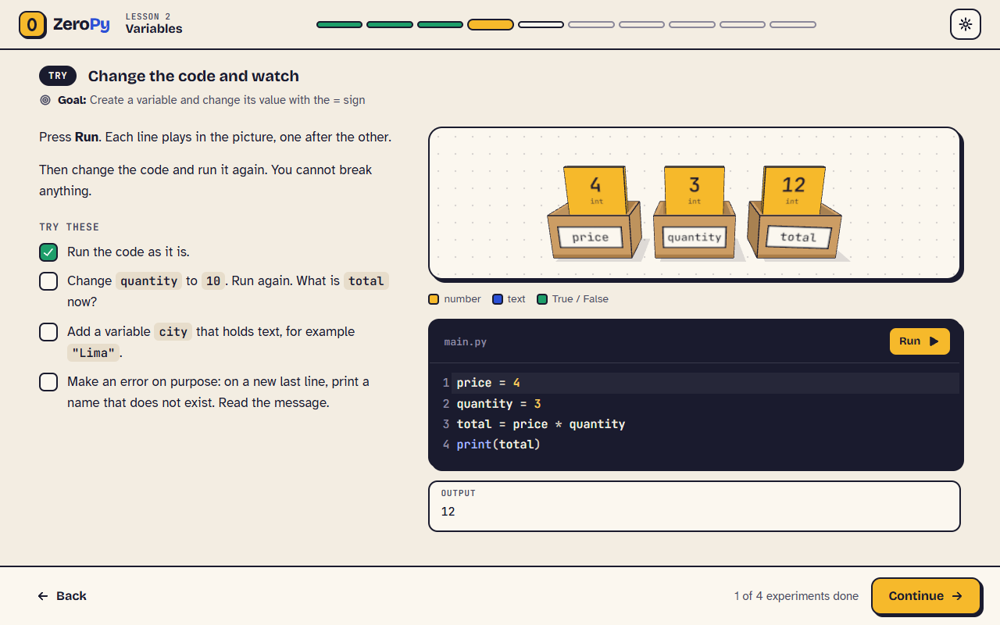
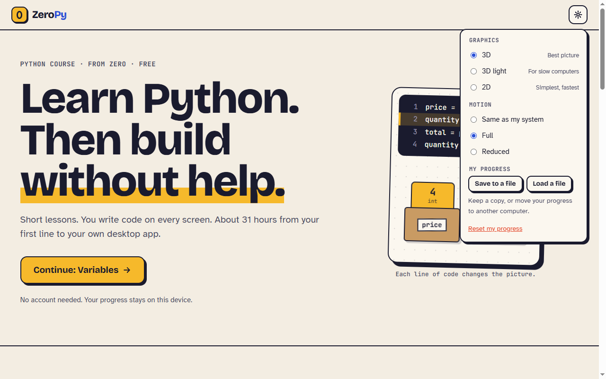

# ZeroPy — learn Python from zero

ZeroPy is a free Python course that runs as a Windows app. It takes you from
your very first line of code to building and packaging your own small
desktop app, in about 31 hours.

- **42 short lessons** in 8 modules. You write real Python on almost every screen.
- **Instant feedback.** Your code runs inside the app and is checked at once.
- **Pictures that move with the code.** Variables, lists and loops are shown
  as 3D (or 2D) scenes, one line at a time.
- **Spaced review.** Cards from earlier lessons come back just before you
  would forget them.
- **Works offline.** Python and everything else are inside the app. No
  account, no internet and no tracking. Your progress stays on your computer.




## Download and install (Windows 10 and 11)

1. Open the [Releases page](../../releases/latest).
2. Download one of these files:
   - **`ZeroPy-Setup-<version>.exe`** — the installer (recommended). It
     installs ZeroPy for your user only, so it needs no administrator
     rights. It adds ZeroPy to the Start menu and the desktop.
   - **`ZeroPy-Portable-<version>.exe`** — no installation; double-click to
     run. It starts a few seconds slower, because it unpacks itself first.
3. Run the file.

### "Windows protected your PC"

The first time, Windows SmartScreen may show this blue window. It appears
because the app has no paid code-signing certificate, and SmartScreen does
not know new apps yet. It does not mean that a virus was found.

To continue: click **More info**, then **Run anyway**.

Only do this if you downloaded the file from this repository's Releases page.

### Your progress

- Progress, review cards and settings are saved automatically on your
  computer (in `%APPDATA%\ZeroPy`). They stay when you close the app and
  when you install a newer version.
- To keep a copy, or to move to another computer: open the **settings**
  (gear icon, top right) → **My progress** → **Save to a file**. Use
  **Load a file** on the other computer.



### Update or uninstall

- **Update:** download the new installer and run it. Your progress stays.
- **Uninstall:** Windows Settings → Apps → ZeroPy → Uninstall. Your
  progress folder is kept, in case you install again. To remove it too,
  delete `%APPDATA%\ZeroPy`.

## Build from source

You need [Node.js](https://nodejs.org/) 22 or newer and
[git](https://git-scm.com/).

```bash
git clone https://github.com/Prafixx/zeropy.git
cd zeropy
npm install
```

| Command | What it does |
|---|---|
| `npm run dev` | Runs the course in your browser at http://localhost:5173 (fast reload while you edit). |
| `npm run desktop` | Builds the course and opens it in the desktop window. |
| `npm run desktop:dist` | Makes the installer and the portable `.exe` in the `release/` folder. |
| `npm run check:content` | Runs every exercise solution through the real checker. |

The first `npm run desktop` downloads the Electron runtime (about 150 MB)
once.

### How it is made

- **Lessons are data.** Each lesson is a YAML file in `content/lessons/`.
  One lesson engine (`src/engine/`) shows all of them.
- **Python in the app:** [Pyodide](https://pyodide.org/) (CPython compiled
  to WebAssembly) runs in a background worker (`src/py/`).
- **Scenes:** [Three.js](https://threejs.org/) and [GSAP](https://gsap.com/),
  each with a lighter 2D version for slow computers (`src/kit/`).
- **Code editor:** [CodeMirror 6](https://codemirror.net/).
- **Desktop app:** [Electron](https://www.electronjs.org/) (`desktop/main.cjs`)
  serves the built course from inside the app, so it works offline.
- **Build:** [Vite](https://vite.dev/) and TypeScript.

## License

ZeroPy is released under the [MIT License](LICENSE). You may use, copy and
change it, also for profit, if you keep the copyright notice "Prafix".

The app includes open source libraries and fonts. Their licenses are in
[THIRD-PARTY-NOTICES.txt](THIRD-PARTY-NOTICES.txt).

---

Made by Prafix, with AI assistance.
