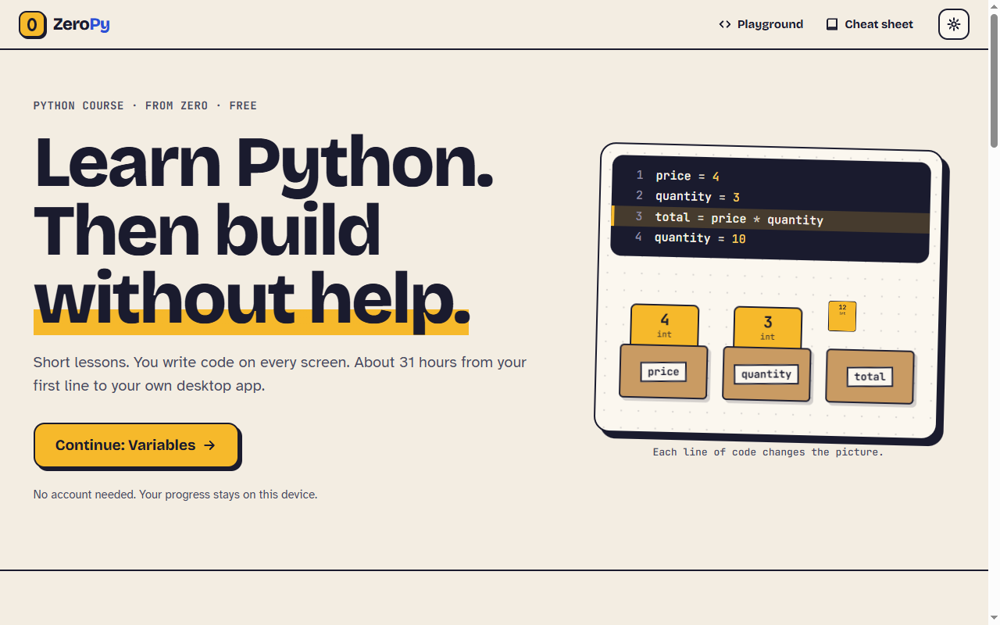
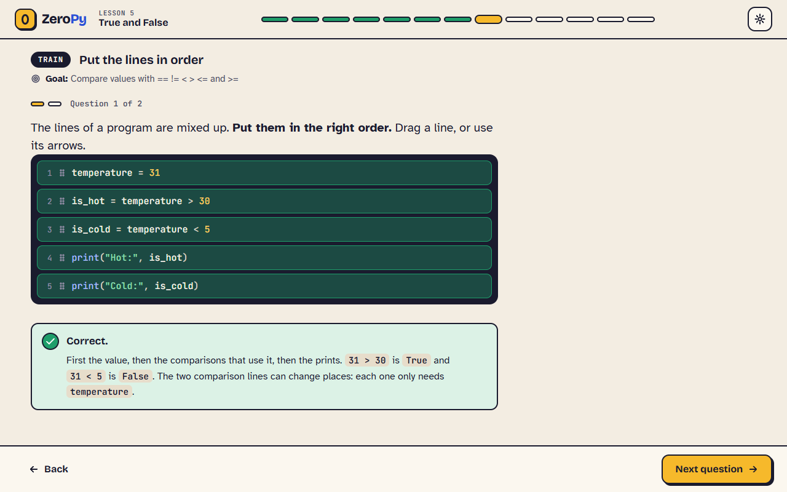
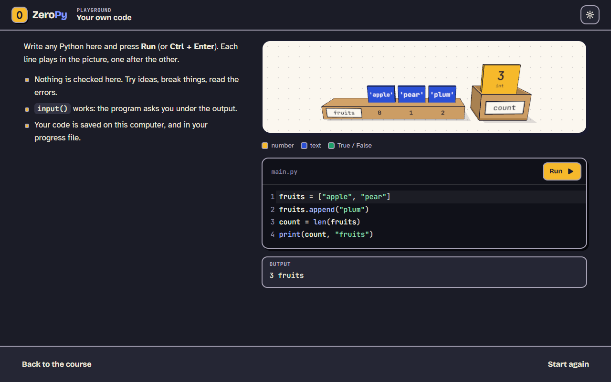
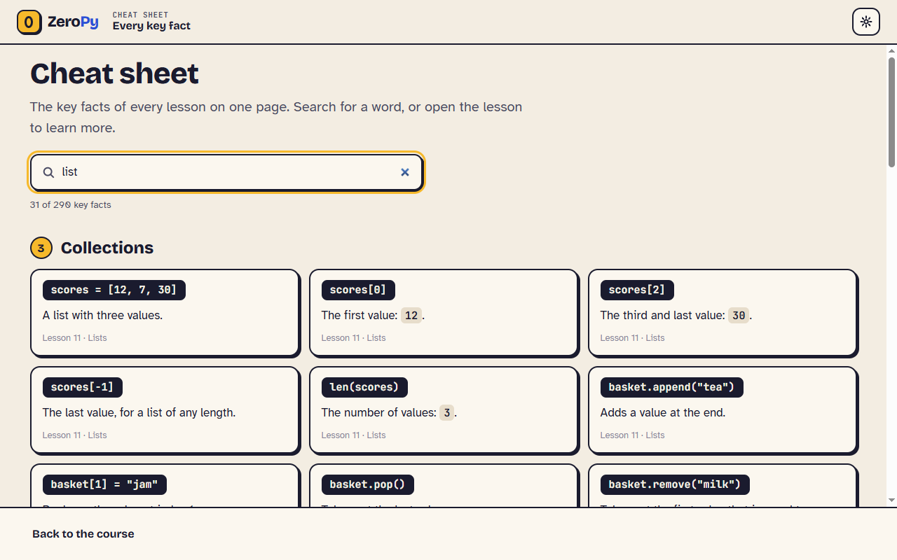

# ZeroPy — learn Python from zero

ZeroPy is a free Python course that runs as a Windows app. It takes you from
your very first line of code to building and packaging your own small
desktop app, in about 31 hours.

- **52 short lessons** in 8 modules, plus four paths: Linux, Raspberry Pi, Data and AI, and the web. You write real Python on almost every screen.
- **Instant feedback.** Your code runs inside the app and is checked at once.
- **Pictures that move with the code.** Variables, lists and loops are shown
  as 3D (or 2D) scenes, one line at a time.
- **Code puzzles.** Put the mixed-up lines of a program in order: 33
  puzzles in 24 lessons. Python checks your order, so any order that works
  is right.
- **Be the computer.** Trace tables: you run a program in your head and
  write each new value, line by line. Python's real run is the answer key.
- **How does it work?** After you play with a demo, short questions ask
  how its code works: click the line that does something, or say what
  changes if a line changes.
- **Mixed practice.** Exercises and questions from many lessons, in a
  mixed order, so you learn to choose the right tool yourself. The tasks
  you practiced longest ago come first.
- **Solved examples with goals.** Each example is split into short goals,
  like "Get the data", "Compute", "Show the result", so you learn the plan,
  not only the code.
- **Spaced review.** Cards from earlier lessons come back just before you
  would forget them.
- **Paths after Python.** When the Python a path needs is solid, a new
  path opens (or open it yourself at any time). The first one: **Linux and
  the command line**, with a pretend Linux terminal in the app. You type
  real commands (`ls`, `cd`, `mkdir`, `grep`, pipes, scripts, `sudo apt`),
  and a picture of your folders changes with each one. Scripts with
  variables, `if` and `for`; processes, services and logs (`ps`, `kill`,
  `systemctl`, `journalctl`), up to your own Python program that starts at
  boot; archives and links (`tar`, `zip`, `ln -s`), the network (`ip`,
  `/etc/hosts`) and users and groups (`adduser`, `usermod`, `chown`).
  Nothing on your computer changes.
- **Raspberry Pi and electronics.** A pretend Raspberry Pi on screen: the
  pin header, LEDs, a button you can press, a buzzer, traffic lights, a
  distance sensor, a light sensor, a motion sensor, a knob, motors and a
  two-wheel robot that drives on a floor. You write real `gpiozero` code (the same
  class names and pin numbers as on a real Pi), and the board plays it in
  real time. Wiring and safety are part of the lessons. Then a real Pi:
  the parts, Raspberry Pi Imager, updates, power problems, and working
  from your PC with `ssh` and `scp` (a pretend PowerShell and Pi, with the
  real questions and messages).
- **Data and AI basics.** Describe a table of data, calculate with real
  `numpy` inside the app, and draw line, bar and scatter charts with the
  names of `matplotlib`. Then build your first AI models yourself: a
  straight line that predicts a number, and nearest neighbours that sort
  into classes. Measure them on test data, and learn when a good score
  lies. At the end, train a real model with `pandas` and `scikit-learn`
  on your own computer.
- **Networks and the web.** How the web works: URLs, requests, responses
  and status codes. Then your own web server with real `Flask` inside the
  app: pages, forms, templates and a JSON API, with a small browser that
  shows each page and the HTTP messages behind it. At the end, run your
  site on your own computer or a Raspberry Pi, and open it from your phone.
- **My knowledge.** From your answers, the app estimates how well you know
  each topic: not yet, learning, solid or mastered. Without practice a topic
  slowly drops again. Your weakest topics get a practice button.
- **Skip what you do not want.** Any lesson can be skipped, and included
  again later. Skipped lessons leave your next steps, reviews and practice.
- **My mistakes.** Every question you answered wrong, and every exercise
  that needed the solution, in one list. Practice them until they leave it.
- **Playground.** Write any Python you like and watch it run, with no
  checks. Your code is saved.
- **Cheat sheet.** Every key fact of the course on one searchable page.
- **What next.** A path after the course, with free resources: computer
  science basics, AI, and Raspberry Pi.
- **Light or dark.** Follows your Windows setting, or choose in the settings.
- **Works offline.** Python and everything else are inside the app. No
  account, no internet and no tracking. Your progress stays on your computer.
  The app goes online only if you click **Check for updates** (settings) or
  a link to another site.










## Download and install (Windows 10 and 11)

1. Open the [Releases page](../../releases/latest).
2. Download one of these files:
   - **`ZeroPy-Setup-<version>.exe`** — the installer (recommended). It
     installs ZeroPy for your user only, so it needs no administrator
     rights. It adds ZeroPy to the Start menu and the desktop.
   - **`ZeroPy-Portable-<version>.exe`** — no installation; double-click to
     run. It starts a few seconds slower, because it unpacks itself first.
3. Run the file.

### "Windows protected your PC"

The first time, Windows SmartScreen may show this blue window. It appears
because the app has no paid code-signing certificate, and SmartScreen does
not know new apps yet. It does not mean that a virus was found.

To continue: click **More info**, then **Run anyway**.

Only do this if you downloaded the file from this repository's Releases page.

### Your progress

- Progress, review cards and settings are saved automatically on your
  computer (in `%APPDATA%\ZeroPy`). They stay when you close the app and
  when you install a newer version.
- To keep a copy, or to move to another computer: open the **settings**
  (gear icon, top right) → **My progress** → **Save to a file**. Use
  **Load a file** on the other computer. The file also holds your
  Playground code.

### Update or uninstall

- **Update (version 0.4.0 and newer, installed version):** open the
  **settings** → **Check for updates** → **Download and install** →
  **Restart now**. The app updates itself, and your progress stays. The
  update is checked against its SHA-512 checksum before it is installed.
- **Update from 0.3.0 or older, or the portable version:** download the new
  file from the Releases page and run it. Your progress stays.
- **Uninstall:** Windows Settings → Apps → ZeroPy → Uninstall. Your
  progress folder is kept, in case you install again. To remove it too,
  delete `%APPDATA%\ZeroPy`.

## Build from source

You need [Node.js](https://nodejs.org/) 22 or newer and
[git](https://git-scm.com/).

```bash
git clone https://github.com/Prafixx/zeropy.git
cd zeropy
npm install
```

| Command | What it does |
|---|---|
| `npm run dev` | Runs the course in your browser at http://localhost:5173 (fast reload while you edit). |
| `npm run desktop` | Builds the course and opens it in the desktop window. |
| `npm run desktop:dist` | Makes the installer and the portable `.exe` in the `release/` folder. |
| `npm run check:content` | Runs every exercise solution through the real checker. |

The first `npm run desktop` downloads the Electron runtime (about 150 MB)
once.

### How it is made

- **Lessons are data.** Each lesson is a YAML file in `content/lessons/`.
  One lesson engine (`src/engine/`) shows all of them.
- **Python in the app:** [Pyodide](https://pyodide.org/) (CPython compiled
  to WebAssembly) runs in a background worker (`src/py/`).
- **Scenes:** [Three.js](https://threejs.org/) and [GSAP](https://gsap.com/),
  each with a lighter 2D version for slow computers (`src/kit/`).
- **Code editor:** [CodeMirror 6](https://codemirror.net/).
- **Desktop app:** [Electron](https://www.electronjs.org/) (`desktop/main.cjs`)
  serves the built course from inside the app, so it works offline.
- **Build:** [Vite](https://vite.dev/) and TypeScript.

## License

ZeroPy is released under the [MIT License](LICENSE). You may use, copy and
change it, also for profit, if you keep the copyright notice "Prafix".

The app includes open source libraries and fonts. Their licenses are in
[THIRD-PARTY-NOTICES.txt](THIRD-PARTY-NOTICES.txt).

---

Made by Prafix, with AI assistance.
